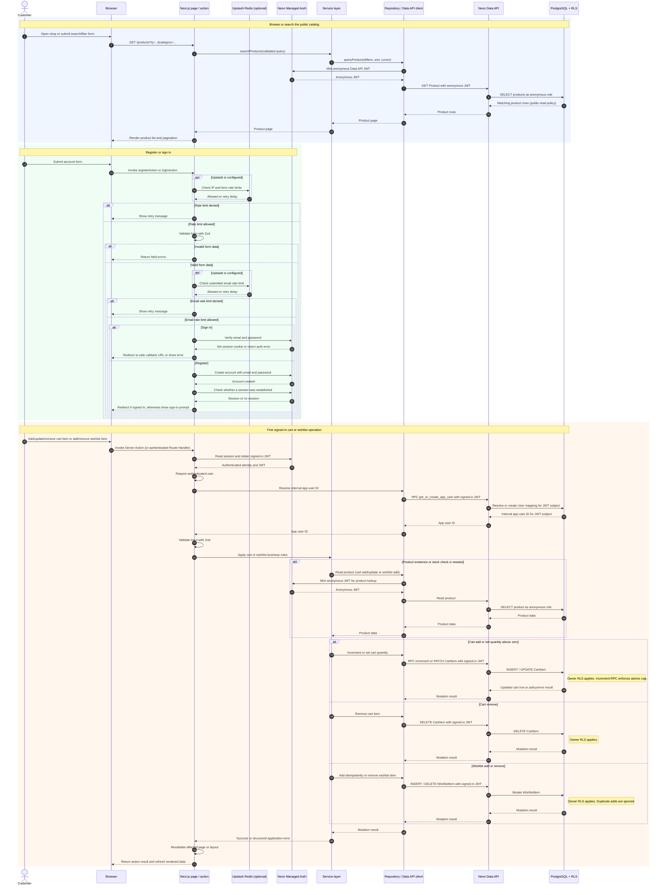

# Application sequence

This sequence diagram follows the main runtime paths: public catalog reads, account registration or sign-in, and a signed-in cart or wishlist mutation. The `DIRECT_URL` Prisma path is for setup and seeding, so it is shown in the component diagram rather than as a runtime request here.

For cart and wishlist page reads, the same authenticated session and app-user mapping are used. The repository reads only rows allowed by RLS, then joins them with public product data before rendering the page.
