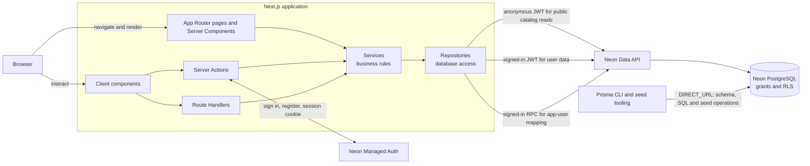

## Architecture

The `User` table is an app-profile mapping with a random internal UUID primary key and a unique Neon Auth subject. Neon Auth owns passwords and sessions in its managed `neon_auth` schema. The SQL setup installs per-user policies for the profile, cart, and wishlist; category and product rows are publicly readable. A narrowly scoped database function creates or returns the mapping using the authenticated Data API JWT subject as the identity source.

All runtime repository requests go through the Neon Data API. Public catalog reads use an anonymous Neon Auth JWT; cart, wishlist, and user-mapping requests use the signed-in user's JWT. The Data API validates the JWT and PostgreSQL applies grants and RLS policies. Prisma is used by local database setup and seed tooling through `DIRECT_URL`; the deployed application does not need a database connection string at runtime.